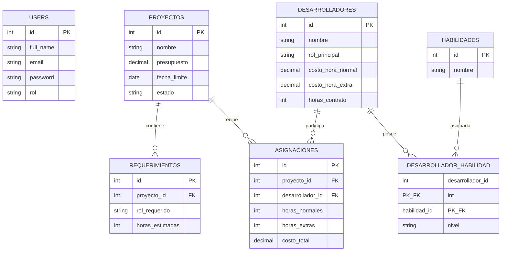

# Analizador de Asignacion para Arquitectura de Software

ERP interno para la gestion de desarrolladores, requerimientos tecnicos, proyectos y presupuestos.

## Enlace del Proyecto Desplegado en Produccion

Espacio reservado para el enlace de la aplicacion en Render:

https://tu-servicio-en-render.onrender.com

---

## Descripcion General del Proyecto

Este sistema corresponde al modulo administrativo de un ERP disenado para empresas de consultoria y desarrollo de software. Su objetivo central consiste en centralizar la gestion de los recursos humanos tecnicos, sus costos por hora, sus habilidades y los requerimientos de los proyectos corporativos.

---

## Explicacion del Core Futuro

El algoritmo central del sistema, que no forma parte de esta entrega administrativa, se encargara de automatizar la asignacion de personal a los proyectos. Dicho motor procesara los requerimientos de cada proyecto, evaluara la disponibilidad de horas contractuales de los desarrolladores, determinara la necesidad de autorizar horas extras y calculara las proyecciones de margen de ganancia empresarial. 

El panel administrativo construido en esta entrega cumple el rol fundamental de alimentar y mantener limpios los datos que el algoritmo consumira mas adelante mediante la tabla de asignaciones.

---

## Arquitectura y Patron MVC

La aplicacion implementa el patron Modelo Vista Controlador respetando una clara separacion de responsabilidades:

1. Modelos:
   Ubicados en el directorio app/models. Utilizan el ORM Lucid para definir el mapeo relacional de datos, las relaciones hasMany, belongsTo, manyToMany con tabla pivote, y la conexion a PostgreSQL.

2. Controladores:
   Ubicados en el directorio app/controllers/admin. Contienen toda la logica de negocio, ejecutan las consultas a la base de datos, gestionan respuestas HTTP y envian la informacion hacia las vistas.

3. Vistas:
   Ubicadas en el directorio inertia/pages/admin. Implementadas con componentes Vue 3 que son renderizados hacia el cliente por medio del adaptador de Inertia.js, conservando el renderizado de aplicacion de pagina unica sin recargar la ventana.

---

## Stack Tecnologico

- Servidor y backend: AdonisJS version 6 bajo Node.js
- Lenguaje: TypeScript
- Frontend: Vue 3 con Composition API y script setup
- Puente de comunicacion: Inertia.js
- Motor de base de datos: PostgreSQL sobre la nube de Neon
- Capa ORM: Lucid ORM
- Validador de esquemas: VineJS
- Bundler y compilador de assets: Vite version 8
- Entorno de despliegue: Render Web Service

---

## Diagrama Entidad Relacion

---

## Modulos y CRUDs del Panel de Administracion

El panel administrativo se encuentra bajo el prefijo de rutas /admin y cuenta con una interfaz sobria en blanco y negro, sin gradientes, sin animaciones ni librerias externas de diseno:

1. Desarrolladores:
   Registro de nombre, rol principal seleccionado de la lista estandar, costo por hora regular, costo por hora extra y horas de contrato mensual. Incluye tabla para asignar habilidades y niveles.

2. Habilidades:
   Catalogo unico de destrezas tecnologicas requeridas por la empresa.

3. Proyectos:
   Administracion de nombre, presupuesto total en dolares, fecha limite de entrega y estado del proyecto.

4. Requerimientos:
   Definicion de las horas estimadas por rol requerido para cada proyecto.

---

## Validaciones de Backend con VineJS

Todas las peticiones enviadas desde los formularios pasan por validadores estrictos en el servidor antes de tocar la base de datos:

1. Desarrolladores:
   - Costo por hora normal: Debe ser un numero mayor a 0.
   - Costo por hora extra: Debe ser un numero mayor o igual al costo por hora normal.
   - Horas de contrato: Debe ser un numero entero mayor a 0, sin decimales.

2. Proyectos:
   - Presupuesto: Debe ser un numero mayor a 0.
   - Fecha limite: Debe ser igual o posterior a la fecha actual, impidiendo fechas del pasado.

3. Requerimientos:
   - Horas estimadas: Debe ser un numero entero mayor a 0, sin decimales.
   - Proyecto: Debe existir obligatoriamente en la tabla proyectos.

4. Respuestas de error:
   Los mensajes de validacion se transmiten en espanol al frontend y se despliegan directamente debajo del campo correspondiente.

---

## Dropdowns Dependientes y Selects de Llaves Foraneas

Para garantizar la integridad referencial y mejorar la experiencia de usuario:

1. Ausencia de inputs manuales:
   Ningun formulario solicita digitar llaves foraneas o identificadores numericos a mano. Los proyectos se eligen por su nombre en un elemento select y los roles provienen de la lista estandar ROLES_DISPONIBLES.

2. Dropdown dependiente con watch en Vue:
   En la vista de asignacion de habilidades, el usuario elige primero un rol principal. Al cambiar dicho valor, un observador watch ejecuta una llamada fetch asincrona al endpoint JSON /admin/api/desarrolladores-por-rol?rol=valor. El segundo desplegable de desarrolladores se desbloquea y se llena exclusivamente con los profesionales que cumplen dicho rol, permitiendo luego fijar la habilidad y el nivel de dominio sin margen de error.

---

## Seguridad y Control de Acceso

1. Autenticacion base:
   Permite el inicio de sesion y registro de usuarios estandar con contrasenas encriptadas.

2. Middleware Admin:
   Intercepta todas las solicitudes hacia el prefijo /admin. Si un usuario no autenticado o con rol user intenta acceder, el servidor retorna codigo de estado 403 Forbidden o lo redirige al inicio, protegiendo los datos estrategicos.

---

## Administrador de Prueba

El sistema cuenta con un seeder que configura de forma idempotente al usuario administrador:

- Correo: admin@erp.com
- Clave: Admin12345!
- Rol: admin

---

## Variables de Entorno

El archivo .env debe contener las siguientes variables para su correcto funcionamiento:

- NODE_ENV: Entorno de ejecucion, development o production.
- HOST: Direccion de escucha del servidor, localhost en local o 0.0.0.0 en Render.
- PORT: Puerto de red para el servidor HTTP.
- APP_KEY: Llave criptografica generada por AdonisJS.
- LOG_LEVEL: Nivel de detalle del registrador de eventos, por ejemplo info.
- SESSION_DRIVER: Metodo de persistencia de sesion, por ejemplo cookie.
- DATABASE_URL: Cadena de conexion completa a PostgreSQL Neon con parametro sslmode require.
- ADMIN_EMAIL: Correo electronico para el usuario administrador del seeder.
- ADMIN_PASSWORD: Clave de acceso para el usuario administrador del seeder.

---

## Instalacion y Ejecucion Local

1. Clonar el repositorio:
   git clone https://github.com/johann122003/Proyecto-Ingenieria-WEB.git
   cd Proyecto-Ingenieria-WEB

2. Instalar dependencias del proyecto:
   npm install

3. Configurar el entorno:
   Copiar el archivo .env.example como .env y rellenar las credenciales correspondientes.
   Generar una clave de aplicacion con el comando:
   node ace generate:key

4. Ejecutar las migraciones en PostgreSQL:
   node ace migration:run

5. Ejecutar los seeders con los datos de prueba:
   node ace db:seed

6. Iniciar el servidor en modo desarrollo:
   npm run dev

La aplicacion estara disponible en la direccion:
http://localhost:3333

---

## Comandos para Despliegue en Render

En la configuracion del Web Service en Render se deben establecer los siguientes parametros:

- Build Command:
  npm install && npm run build

- Start Command:
  node ace migration:run --force && node ace db:seed && node build/bin/server.js
